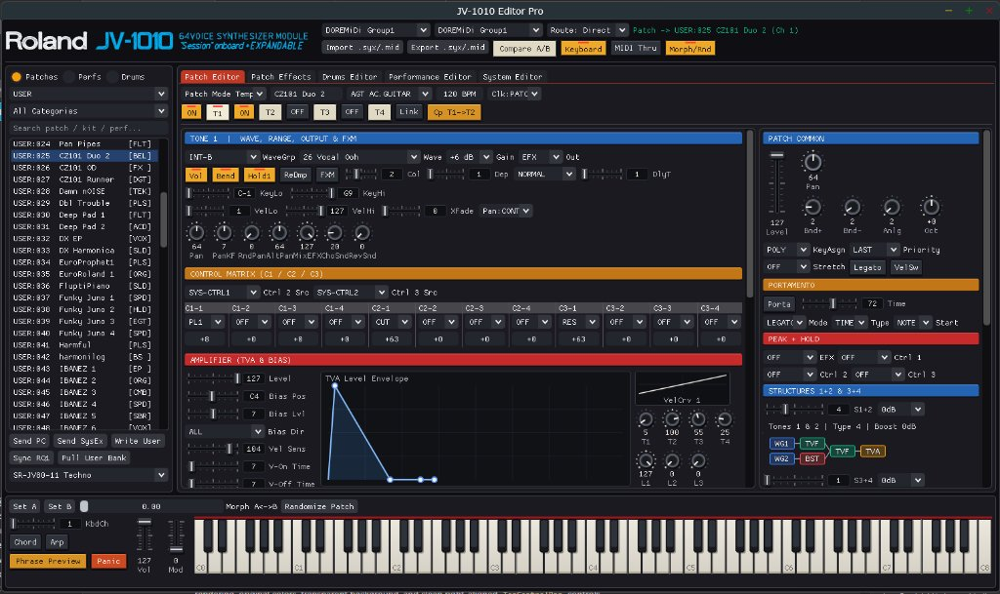

# Roland JV-1010 Visual Editor & Librarian (JV-1010 Editor Pro)

**Idiomas:** [English](README.md) | **Español** | [Português](README.pt.md) | [Français](README.fr.md)

[](https://cafecito.app/martinrevert) [](https://www.paypal.me/tinchorevert)



## Objetivo del Proyecto

**JV-1010 Editor Pro** es un **Editor Visual MIDI/SysEx, Librero y aplicación Standalone / plugin VST3 autónomo** de código abierto para el sintetizador **Roland JV-1010** (compatible además con importación de patches `.syx`/`.mid` de JV-1080, JV-2080 y serie XP).

Su objetivo es ofrecer control visual completo y en tiempo real sobre todos los parámetros internos del JV-1010 —que en el panel frontal del hardware están limitados a un visor LED de 3 dígitos— mediante una interfaz fotorrealista estilo hardware en **Dear ImGui (OpenGL3)** sobre **C++20** y **JUCE 8**.

## Características Principales

- **Standalone y VST3 Autónomo**: Funciona directamente con puertos MIDI físicos tanto en modo Standalone como VST3, o a través del bus MIDI del DAW, con MIDI Thru/Merge configurable y cola SysEx con pacing seguro para el hardware.
- **Patch Editor Todo-en-Uno**:
  - Edición completa de los 4 Tones (`Wave Group`, `Wave #`, `Gain`, `FXM`, `Delay`, rangos `Key/Vel` con nombres de notas musicales, `Pan`, `Output Assign`, envíos `Mix/Chorus/Reverb`, `Link All Active Tones`, `Copy Tone`).
  - **Control Matrix de 12 ranuras** (`C1-1..C3-4`) en grilla horizontal compacta.
  - **Envolventes apiladas simultáneas** (**Amplifier TVA**, **Filter TVF** y **Pitch**) con gráficas interactivas arrastrables (`EnvelopeGraph`), curvas visuales de velocidad (`VelocityCurvePreview 1..7`) y parámetros `V-On/V-Off/Time KF`.
  - **Patch Common y LFO 1/2**: Fader `Patch Level`, `Portamento` completo (`Switch/Mode/Type/Time/Start`), bloque `Peak + Hold` (`EFX/C1/C2/C3`), diagramas de topología `Structures 1+2 & 3+4` y tabla comparativa `LFO 1 vs LFO 2`.
- **Patch Effects (`40 EFX + Chorus + Reverb/Delay`)**: Mapeo dinámico de parámetros para los 40 algoritmos EFX de Roland, además de switches rápidos `Master EFX / Chorus / Reverb` y botón `Route Active Tones -> EFX` en un clic.
- **Performance Mixer (16 Partes)**: Canales con faders verticales `FaderV`, Pan, Sends, afinación Coarse/Fine, rangos de teclado, Voice Reserve (`64` voces en total) y edición directa del Patch de cada parte.
- **Drums / Rhythm Kit Editor**: Inspector de 64 notas para Rhythm Kits (`Tone`, `Wave`, `Mute Group`, `Pitch`, `Filter`, `TVA`, `Env`).
- **System Editor y Scale Tuning Microtonal**: Afinación maestra, canales de recepción/control, configuración de Phrase Preview y Scale Tuning de 12 notas (con presets `Equal`, `Just`, `Arabian` y envío `GS 42H` opcional).
- **Librero, Detección de Expansión y Sincronización**:
  - Navegador para `USER`, `PR-A..E`, `XP-A (Session)` y `XP-B` (detección automática y selector manual de placas `SR-JV80-01..19`, incluyendo sus Drum Kits).
  - Cambio automático de modo (`PATCH` / `PERFORM`) y sincronización `RQ1` al seleccionar Patches, Performances o Rhythm Kits.
  - Recuperación rápida de nombres del banco `USER` (`128` Patches, `32` Performances, `2` Rhythm Sets) y volcado completo de memoria User.
  - Importación `.syx` / `.mid` (con remapeo Cross-JV y envío automático inmediato al sintetizador) y exportación, `Compare A/B`, `Patch Morph / Randomize` y **Teclado Virtual** con `Chord`, `Arp`, `Phrase Preview` y `Mod Wheel`.

## Compilación y Pruebas (Windows / MSVC)

```powershell
$env:_CL_="/Z7"
cmake -B build -G "Visual Studio 17 2022" -A x64
cmake --build build --target JV1010Tests JV1010EditorPro_VST3 JV1010EditorPro_Standalone --config Release
.\build\Release\JV1010Tests.exe
```
