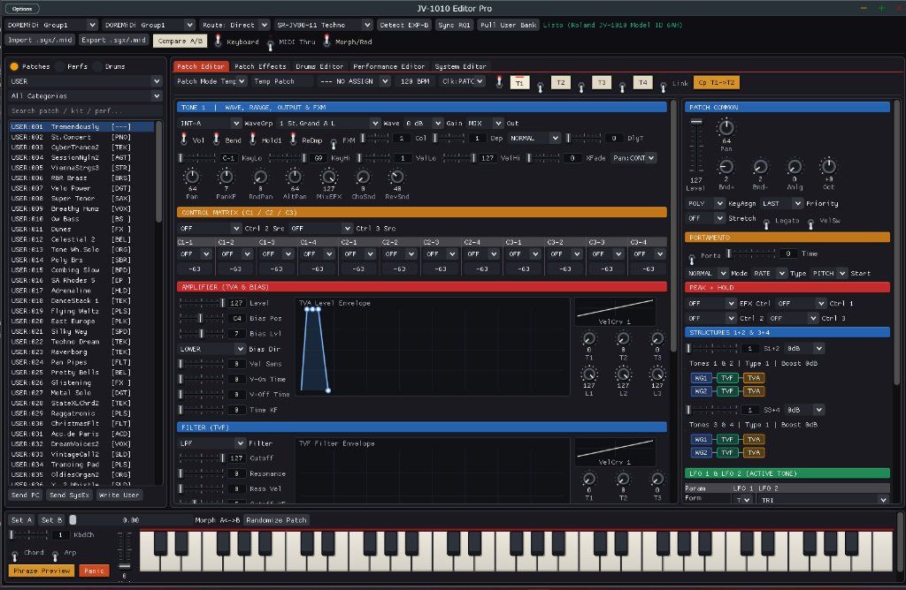

# Roland JV-1010 Visual Editor & Librarian (JV-1010 Editor Pro)

**Langues :** [English](README.md) | [Español](README.es.md) | [Português](README.pt.md) | **Français**



## Objectif du Projet

**JV-1010 Editor Pro** est un **Éditeur Visuel MIDI/SysEx, Bibliothécaire et application Standalone / plugin VST3 autonome** open-source pour le synthétiseur **Roland JV-1010** (également compatible avec l'import `.syx`/`.mid` des séries JV-1080, JV-2080 et XP).

Son objectif est d'offrir un contrôle visuel complet en temps réel sur chaque paramètre interne du JV-1010 —limité sur la façade matérielle à un afficheur LED à 3 chiffres— grâce à une interface photoréaliste inspirée du matériel Roland en **Dear ImGui (OpenGL3)** propulsée par **C++20** et **JUCE 8**.

## Fonctionnalités Clés

- **Standalone & VST3 Autonome** : Fonctionne directement avec les ports MIDI physiques en modes Standalone et VST3, ou via le bus MIDI du DAW, avec MIDI Thru/Merge configurable et file SysEx cadencée.
- **Éditeur de Patch Tout-en-Un** :
  - Édition complète des 4 Tones (`Wave Group`, `Wave #`, `Gain`, `FXM`, `Delay`, plages `Key/Vel` avec noms de notes musicales, `Pan`, `Output Assign`, départs `Mix/Chorus/Reverb`, `Link All Active Tones`, `Copy Tone`).
  - **Matrice de Contrôle à 12 emplacements** (`C1-1..C3-4`) dans une grille horizontale compacte.
  - **Enveloppes empilées simultanées** (**Amplifier TVA**, **Filter TVF** et **Pitch**) avec graphiques interactifs (`EnvelopeGraph`), courbes de vélocité visuelles (`VelocityCurvePreview 1..7`) et paramètres `V-On/V-Off/Time KF`.
  - **Patch Common & Double LFO** : Fader `Patch Level`, `Portamento` complet (`Switch/Mode/Type/Time/Start`), bloc `Peak + Hold` (`EFX/C1/C2/C3`), diagrammes `Structures 1+2 & 3+4` et tableau comparatif `LFO 1 vs LFO 2`.
- **Effets de Patch (`40 EFX + Chorus + Reverb/Delay`)** : Paramètres dynamiques pour les 40 algorithmes EFX Roland, interrupteurs rapides `Master EFX / Chorus / Reverb` et bouton `Route Active Tones -> EFX` en un clic.
- **Mixeur Performance (16 Parties)** : Tranches avec faders verticaux `FaderV`, Pan, Sends, accordage Coarse/Fine, plages clavier, Voice Reserve (`64` voix au total) et édition directe du Patch de chaque partie.
- **Éditeur Drums / Kits Rythmiques** : Inspecteur 64 notes pour les kits rythmiques (`Tone`, `Wave`, `Mute Group`, `Pitch`, `Filter`, `TVA`, `Env`).
- **Système & Accordage Microtonal** : Accordage maître, canaux MIDI, configuration Phrase Preview et Scale Tuning à 12 notes (préréglages `Equal`, `Just`, `Arabian` et envoi `GS 42H` optionnel).
- **Bibliothécaire, Cartes d'Extension & Synchronisation** :
  - Navigation dans `USER`, `PR-A..E`, `XP-A (Session)` et `XP-B` (détection automatique et sélecteur manuel des cartes `SR-JV80-01..19`, incluant leurs kits rythmiques).
  - Changement automatique de mode (`PATCH` / `PERFORM`) et synchronisation `RQ1` lors de la sélection de Patches, Performances ou Kits.
  - Récupération rapide des noms de la banque `USER` (`128` Patches, `32` Performances, `2` Kits) et dump complet de la mémoire utilisateur.
  - Import `.syx` / `.mid` (avec remappage Cross-JV et envoi automatique immédiat vers le synthétiseur) & export, `Compare A/B`, `Patch Morph / Randomize`, et **Clavier Virtuel** avec `Chord`, `Arp`, `Phrase Preview` et `Mod Wheel`.

## Compilation & Tests (Windows / MSVC)

```powershell
$env:_CL_="/Z7"
cmake -B build -G "Visual Studio 17 2022" -A x64
cmake --build build --target JV1010Tests JV1010EditorPro_VST3 JV1010EditorPro_Standalone --config Release
.\build\Release\JV1010Tests.exe
```
