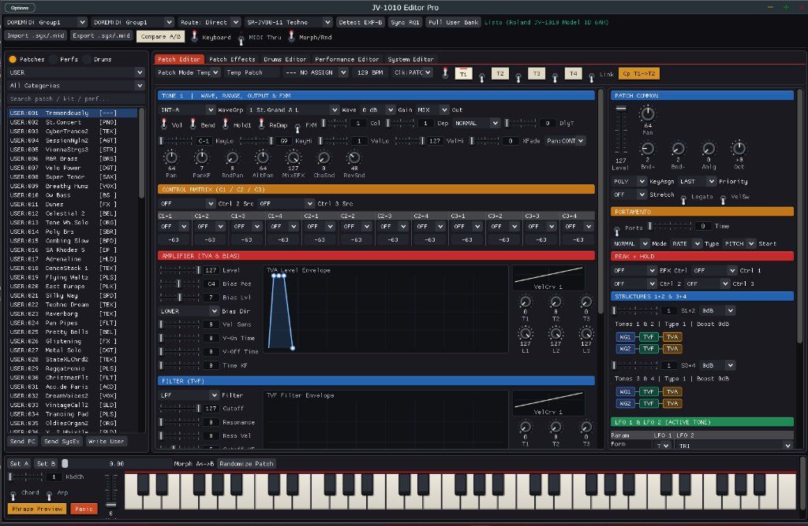

# Roland JV-1010 Visual Editor & Librarian (JV-1010 Editor Pro)

**Languages:** **English** | [Español](README.es.md) | [Português](README.pt.md) | [Français](README.fr.md)



## Project Goal

**JV-1010 Editor Pro** is an open-source, high-density **Visual MIDI/SysEx Editor, Librarian, and Autonomous VST3 / Standalone Application** for the **Roland JV-1010** synthesizer (also compatible with JV-1080, JV-2080, and XP-series `.syx`/`.mid` patch imports).

Its goal is to give complete real-time visual control over every internal parameter of the JV-1010—which on the hardware front panel is limited to a 3-digit LED display—using a photorealistic hardware-inspired **Dear ImGui (OpenGL3)** interface powered by **C++20** and **JUCE 8**.

## Key Features

- **Autonomous Standalone & VST3 Plugin**: Works directly with physical MIDI ports in both Standalone and VST3 modes, or through your DAW MIDI bus, with configurable MIDI Thru/Merge and paced SysEx transmission.
- **All-in-One Patch Editor**:
  - Edit all 4 Tones (`Wave Group`, `Wave #`, `Gain`, `FXM`, `Delay`, `Key/Vel Ranges` with musical note readouts, `Pan`, `Output Assign`, `Mix/Chorus/Reverb Sends`, `Link All Active Tones`, `Copy Tone`).
  - **12-Slot Control Matrix** (`C1-1..C3-4`) in a compact horizontal grid.
  - **Simultaneous Stacked Envelopes** (**Amplifier TVA**, **Filter TVF**, and **Pitch**) with interactive draggable `EnvelopeGraph`s, `VelocityCurvePreview` (`1..7`), and `V-On/V-Off/Time KF` parameters.
  - **Patch Common & Dual LFOs**: `Patch Level` fader, `Portamento` (Switch/Mode/Type/Time/Start), `Peak + Hold` (`EFX/C1/C2/C3`), `Structures 1+2 & 3+4` topology diagrams, and side-by-side `LFO 1 & 2` comparison table.
- **Patch Effects (`40 EFX + Chorus + Reverb/Delay`)**: Dynamic parameter mapping for all 40 Roland EFX algorithms, plus quick `Master EFX / Chorus / Reverb` switches and one-click `Route Active Tones -> EFX`.
- **16-Part Performance Mixer**: Channel strips with `FaderV` level sliders, Pan, Sends, Coarse/Fine Tune, Key Ranges, Voice Reserve (`64` voices total), and direct Part Patch editing.
- **Drums / Rhythm Kit Editor**: 64-note Rhythm Kit inspector (`Tone`, `Wave`, `Mute Group`, `Pitch`, `Filter`, `TVA`, `Env`).
- **System & Microtonal Scale Tuning**: Master Tune, Receive/Control channels, Phrase Preview config, and 12-note Scale Tuning (with `Equal`, `Just`, `Arabian` presets and optional `GS 42H` SysEx).
- **Librarian, Expansion Detection & Hardware Sync**:
  - Browse `USER`, `PR-A..E`, `XP-A (Session)`, and `XP-B` (`SR-JV80-01..19` auto-detection & manual selector, including expansion Drum Kits).
  - Automatic mode switching (`PATCH` / `PERFORM`) and paced `RQ1` sync when selecting Patches, Performances, or Rhythm Kits.
  - Fast User Bank name recovery (`128` Patches, `32` Performances, `2` Rhythm Sets) and full User Bank dump.
  - `.syx` / `.mid` import (with Cross-JV address remapping and automatic transmission to the synth) & export, `Compare A/B`, `Patch Morph / Randomize`, and a **Virtual Keyboard** with `Chord`, `Arp`, `Phrase Preview`, and `Mod Wheel`.

## Build & Test (Windows / MSVC)

```powershell
$env:_CL_="/Z7"
cmake -B build -G "Visual Studio 17 2022" -A x64
cmake --build build --target JV1010Tests JV1010EditorPro_VST3 JV1010EditorPro_Standalone --config Release
.\build\Release\JV1010Tests.exe
```
