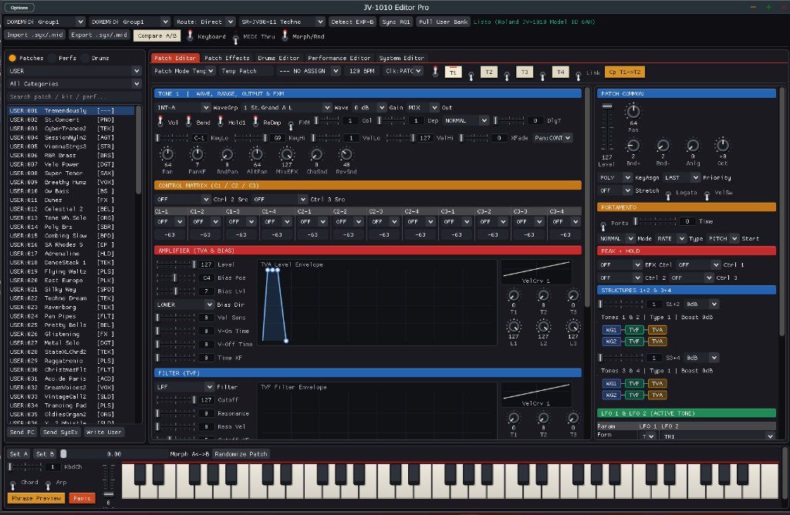

# Roland JV-1010 Visual Editor & Librarian (JV-1010 Editor Pro)

**Idiomas:** [English](README.md) | [Español](README.es.md) | **Português** | [Français](README.fr.md)



## Objetivo do Projeto

**JV-1010 Editor Pro** é um **Editor Visual MIDI/SysEx, Bibliotecário e aplicativo Standalone / plugin VST3 autônomo** de código aberto para o sintetizador **Roland JV-1010** (também compatível com importação `.syx`/`.mid` das séries JV-1080, JV-2080 e XP).

Seu objetivo é oferecer controle visual completo em tempo real sobre todos os parâmetros internos do JV-1010 —que no painel frontal do hardware são limitados a um display LED de 3 dígitos— usando uma interface fotorrealista estilo hardware em **Dear ImGui (OpenGL3)** sobre **C++20** e **JUCE 8**.

## Recursos Principais

- **Standalone e VST3 Autônomo**: Funciona diretamente com portas MIDI físicas nos modos Standalone e VST3, ou pelo barramento MIDI da DAW, com MIDI Thru/Merge configurável e fila SysEx temporizada.
- **Patch Editor Tudo-em-Um**:
  - Edição completa dos 4 Tones (`Wave Group`, `Wave #`, `Gain`, `FXM`, `Delay`, faixas `Key/Vel` com notas musicais, `Pan`, `Output Assign`, envios `Mix/Chorus/Reverb`, `Link All Active Tones`, `Copy Tone`).
  - **Control Matrix de 12 slots** (`C1-1..C3-4`) em grade horizontal compacta.
  - **Envelopes empilhados simultâneos** (**Amplifier TVA**, **Filter TVF** e **Pitch**) com gráficos interativos arrastáveis (`EnvelopeGraph`), curvas visuais de velocidade (`VelocityCurvePreview 1..7`) e parâmetros `V-On/V-Off/Time KF`.
  - **Patch Common e LFO 1/2**: Fader `Patch Level`, `Portamento` completo (`Switch/Mode/Type/Time/Start`), bloco `Peak + Hold` (`EFX/C1/C2/C3`), diagramas `Structures 1+2 & 3+4` e tabela comparativa `LFO 1 vs LFO 2`.
- **Patch Effects (`40 EFX + Chorus + Reverb/Delay`)**: Mapeamento dinâmico para todos os 40 algoritmos EFX da Roland, chaves rápidas `Master EFX / Chorus / Reverb` e botão `Route Active Tones -> EFX` em um clique.
- **Performance Mixer (16 Partes)**: Canais com faders verticais `FaderV`, Pan, Sends, afinação Coarse/Fine, faixas de teclado, Voice Reserve (`64` vozes no total) e edição direta do Patch de cada parte.
- **Drums / Rhythm Kit Editor**: Inspetor de 64 notas para Rhythm Kits (`Tone`, `Wave`, `Mute Group`, `Pitch`, `Filter`, `TVA`, `Env`).
- **System Editor e Scale Tuning Microtonal**: Afinação mestre, canais MIDI, configuração de Phrase Preview e Scale Tuning de 12 notas (com presets `Equal`, `Just`, `Arabian` e envio `GS 42H` opcional).
- **Bibliotecário, Detecção de Expansão e Sincronização**:
  - Navegador para `USER`, `PR-A..E`, `XP-A (Session)` e `XP-B` (detecção automática e seletor manual das placas `SR-JV80-01..19`, incluindo seus Drum Kits).
  - Troca automática de modo (`PATCH` / `PERFORM`) e leitura `RQ1` ao selecionar Patches, Performances ou Rhythm Kits.
  - Recuperação rápida de nomes do banco `USER` (`128` Patches, `32` Performances, `2` Rhythm Sets) e dump completo da memória User.
  - Importação `.syx` / `.mid` (com remapeamento Cross-JV e envio automático imediato para o sintetizador) e exportação, `Compare A/B`, `Patch Morph / Randomize` e **Teclado Virtual** com `Chord`, `Arp`, `Phrase Preview` e `Mod Wheel`.

## Compilação e Testes (Windows / MSVC)

```powershell
$env:_CL_="/Z7"
cmake -B build -G "Visual Studio 17 2022" -A x64
cmake --build build --target JV1010Tests JV1010EditorPro_VST3 JV1010EditorPro_Standalone --config Release
.\build\Release\JV1010Tests.exe
```
